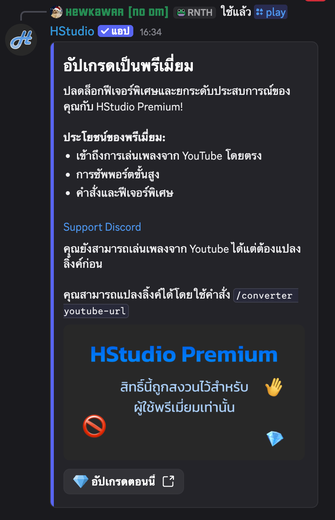
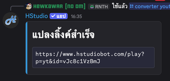
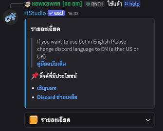
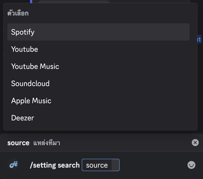
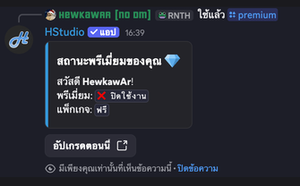
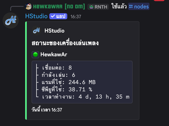

# คำถามที่พบบ่อย

รวมคำถามและวิธีแก้ปัญหาที่พบบ่อยในการใช้งานบอท **HStudio**

## ทำไมเล่นเพลงจากลิงก์ YouTube โดยตรงไม่ได้?

สำหรับผู้ใช้แพ็กเกจฟรี บอทจะไม่สามารถเล่นเพลงจากลิงก์ YouTube โดยตรงได้ และจะแสดงข้อความแจ้งเตือนดังนี้

คุณสามารถเล่นเพลงจาก YouTube ได้ 2 วิธี:

1. **แปลงลิงก์ก่อนเล่นเพลง (ฟรี)**
   - ใช้คำสั่ง `/converter youtube-url` ใน Discord แล้ววางลิงก์ YouTube เพื่อรับลิงก์ HStudio Play
   - หรือแปลงลิงก์ผ่านเว็บไซต์ [hstudiobot.com/play](https://www.hstudiobot.com/play) (ดูขั้นตอนแบบละเอียดได้ที่ [ฟังเพลงจาก YouTube](../guide/play-from-youtube))
   - คัดลอกลิงก์ที่ได้ไปใช้กับคำสั่ง `/play` เพื่อเล่นเพลงได้ทันที

2. **อัปเกรดเป็น HStudio Premium**
   - สามารถวางลิงก์ YouTube ในคำสั่ง `/play` และเล่นเพลงได้ทันทีโดยไม่ต้องแปลงลิงก์

---

## เปลี่ยนภาษาของบอทอย่างไร?

บอท **HStudio** จะเปลี่ยนภาษาตามภาษาของแอป Discord ที่คุณตั้งค่าไว้โดยอัตโนมัติ (รองรับทั้งภาษาไทยและภาษาอังกฤษ)

หากต้องการสลับภาษาของบอท:
1. เปิด **การตั้งค่าผู้ใช้ (User Settings)** ใน Discord
2. ไปที่เมนู **ภาษา (Language)**
3. เลือก **ไทย** สำหรับภาษาไทย หรือ **English, US / UK** สำหรับภาษาอังกฤษ

---

## เปลี่ยนแหล่งค้นหาเพลงเริ่มต้นได้ไหม?

ได้ โดยค่าเริ่มต้นของบอทจะค้นหาเพลงจาก **Spotify** แต่คุณสามารถเปลี่ยนแหล่งค้นหาเริ่มต้นของตัวเองได้ด้วยคำสั่ง `/setting search`

แหล่งค้นหาที่รองรับ:
- **ใช้งานได้ฟรี:** Spotify, SoundCloud, Apple Music, Deezer
- **สำหรับผู้ใช้ HStudio Premium:** YouTube, YouTube Music

::: tip เคล็ดลับ
หากต้องการเปลี่ยนแหล่งค้นหาแค่ครั้งเดียวโดยไม่เปลี่ยนค่าเริ่มต้น สามารถระบุตัวเลือก `source` ในคำสั่ง `/play` ได้เลย (ใช้ได้เฉพาะการพิมพ์ชื่อเพลงเพื่อค้นหา)
:::

---

## ฟีเจอร์ไหนต้องใช้ HStudio Premium และเช็กสถานะอย่างไร?

ฟีเจอร์ที่สงวนสิทธิ์ไว้สำหรับผู้ใช้ **HStudio Premium** ได้แก่:
- เล่นเพลงจากลิงก์ YouTube โดยตรงโดยไม่ต้องแปลงลิงก์
- ตั้งค่าการค้นหาเริ่มต้นเป็น YouTube หรือ YouTube Music (`/setting search`)
- แผงควบคุมเพลงแบบโต้ตอบ (`/control`)
- เปิด/ปิดโฆษณาในบอท (`/setting ads`)
- การซัพพอร์ตขั้นสูงและคำสั่งพิเศษอื่นๆ

คุณสามารถตรวจสอบสถานะ แพ็กเกจ และวันหมดอายุของตัวเองได้ตลอดเวลาด้วยคำสั่ง `/premium` (ข้อความจะแสดงให้เห็นเฉพาะคุณเท่านั้น) หรือดูรายละเอียดเพิ่มเติมที่ [hstudiobot.com/premium](https://www.hstudiobot.com/premium)

---

## เพลงกระตุก โหลดไม่ขึ้น หรือบอทไม่เข้าห้องเสียง แก้ยังไง?

สามารถตรวจสอบและแก้ไขเบื้องต้นได้ตามขั้นตอนต่อไปนี้:

1. **ตรวจสอบว่าคุณอยู่ในห้องเสียง (Voice Channel)** ก่อนใช้คำสั่งเล่นเพลง
2. **ตรวจสอบสิทธิ์ของบอท** ว่ามีสิทธิ์เข้าห้องเสียงและพูดครบถ้วน ดูวิธีตั้งค่าได้ที่ [แก้ปัญหาบอทไม่มีสิทธิ์เล่นเพลง](./bot-permission)
3. **เช็กสถานะเครื่องเล่นเพลง (Node)** ด้วยคำสั่ง `/nodes` หรือหน้า [สถานะระบบ HStudio](https://www.hstudiobot.com/status)

4. **ลองเลือก Node หรือรีเซ็ตการเชื่อมต่อ**
   - หากมีหลาย Node ออนไลน์ สามารถเลือก Node อื่นผ่านตัวเลือก `node` ในคำสั่ง `/play` หรือ `/playlist`
   - หากบอทค้างอยู่ในห้องเสียง ให้ใช้คำสั่ง `/leave` แล้วสั่ง `/play` ใหม่อีกครั้ง

---

## เล่นเพลย์ลิสต์และควบคุมคิวเพลงยังไง?

- **เล่นเพลย์ลิสต์ส่วนตัว:** สร้างหรือจัดการเพลย์ลิสต์ของคุณบนเว็บไซต์ [hstudiobot.com](https://www.hstudiobot.com) จากนั้นใช้คำสั่ง `/playlist` ใน Discord เพื่อเลือกเล่นเพลย์ลิสต์ที่บันทึกไว้ได้ทันที
- **ฟังและจัดการคิวผ่านหน้าจอ:** สามารถเปิด [HStudio Activity](../guide/listen-from-activity) ในห้องเสียงเพื่อค้นหาและเพิ่มเพลงลงคิวได้ง่ายขึ้น
- **คำสั่งควบคุมเพลงพื้นฐาน:**
  - `/play` — เล่นเพลงหรือเพิ่มเพลงลงคิว
  - `/pause` / `/resume` — หยุดเพลงชั่วคราว / เล่นเพลงต่อ
  - `/skip` — ข้ามไปยังเพลงถัดไป
  - `/queue` — ดูรายการเพลงในคิว
  - `/loop` — เปิด/ปิดการเล่นซ้ำ (เพลงปัจจุบันหรือทั้งคิว)
  - `/shuffle` — สุ่มลำดับเพลงในคิว
  - `/seek` — เลื่อนช่วงเวลาของเพลงที่กำลังเล่น
  - `/volume` — ปรับระดับเสียง (`1`–`200`)
  - `/clear` — ล้างคิวเพลงทั้งหมด
  - `/leave` — ให้บอทออกจากห้องเสียง

---

## หากยังพบปัญหา ติดต่อทีมงานได้ที่ไหน?

สามารถพิมพ์คำสั่ง `/help` เพื่อดูรายการคำสั่งและลิงก์ที่มีประโยชน์ หรือเข้าร่วมเซิร์ฟเวอร์ [HStudio Support Discord](https://discord.gg/GzTbuZHTEx) เพื่อสอบถามและแจ้งปัญหากับทีมงานได้โดยตรง
